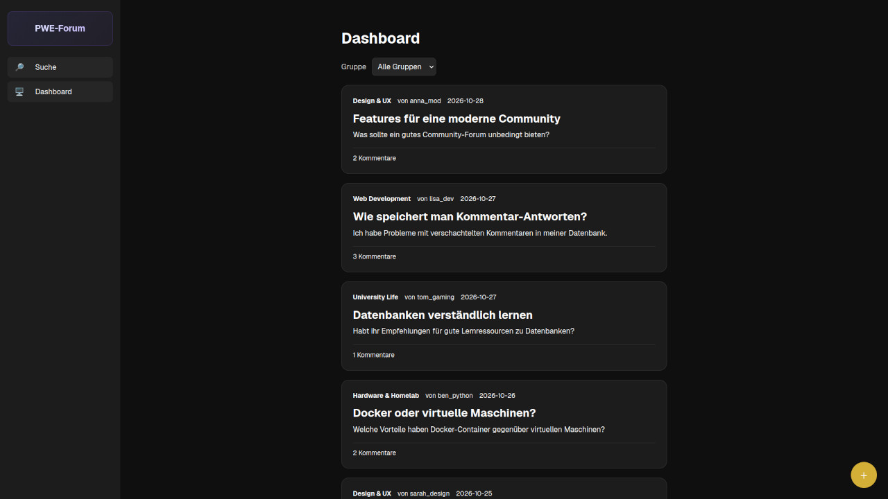

<h1>
  
  PWE-2026Q4
</h1>

Repository für das Uni-Modul **Projekt: Webenticklung**. Ziel dieses Projektes ist es, ein funktionsfähiges, web-basiertes und einfach aufzusetzendes Frage-Anwtort-Forum,
ähnlich wie [Reddit](https://www.reddit.com/), zu entwickeln. Der Fokus liegt hierbau auf der Funktionalität des Forums. Das Forum ermöglicht einen weltweiten und
interaktiven Austausch von unterschiedlichsten Themen und Personen.



#### Technologien

- ```React```
- ```Vite```
- ```FastAPI```
- ```PostgreSQL```
- ```Docker```

## Starten

#### Ports
```
➜  Frontend:    5173
➜  Backend/API: 8000
➜  Datenbank:   5432
```
#### Startvorgang
```bash
# Linux
cd docker
bash start.sh


# Windows

#➜ Docker Desktop starten!
cd docker
cmd /c start.bat
# !WICHTIG! Docker Desktop muss im Hintergrund laufen, da die Docker Ressourcen sonst nicht gefunden werden!
```

## Features

#### Sections

- Search
- Dashboard
- Groups
- Explore Page
- Categories
- Direct Messages
- Profile Page

## Sonstiges

#### Geplante Funktionen / Anforderungen

- **Grundidee**: Frage-Antwort Web-Forum
- Frontend für User mit Login
- Erstellen und kommentieren von Beiträgen
- Durchsuchen bestehender Beiträge via Text und Schlagwörter
- Profilansicht mit Profilbild, Userinfos und Beitragsübersicht
- Erstellen von Gruppen / Communities mit untergeordneten Beiträgen
- Logik für Registrierung neuer User und Passwortänderungen
- Admin- und Moderationsansicht, User- und Beitragsverwaltung
- Backend, welches über Frontend erreichbar ist
- Zugangs- und Rechteprüfung auf Backendebene (bsp. verhindern von Datenmanipulation durch User)
- Datenbank, die nur für das Backend erreichbar ist
- Datenbank zur Speicherung und Verwaltung von Userdaten, Beiträgen, etc.

#### Bedeutung ROllen IDs

- 1 Administrator
- 2 Moderator
- 3 User 


#### Autoren

- [Henk Zimmermann](https://github.com/HenkZimmermann)
- [Tim Holtkötter](https://github.com/TymHolt)
